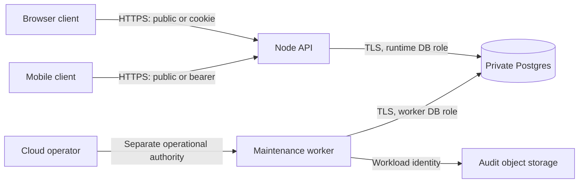

# Architecture

Version 1.0.0. Approved defaults under the user's 2026-10-13 delegation. This owner defines components, contracts, storage and topology. Product rules: [REQUIREMENTS](REQUIREMENTS.md). Boundary policy: [SECURITY](SECURITY.md). Presentation: [DESIGN](DESIGN.md). Commands and release workflow: [AGENTS](AGENTS.md). These are implementation contracts, not a deployed-system description. Historical rationale for the original React/React Native/Node/Postgres selection was not supplied; the rationale below is a new decision.

## Selected technologies

Pin direct dependencies exactly, commit the pnpm lock, and review future updates under SEC-SUPPLY-01. Versions were checked against the official package registry or vendor documentation on 2026-10-13; they do not establish absence of vulnerabilities.

| Area | Launch decision | Rationale |
| --- | --- | --- |
| Runtime/language | Node.js 24.21.0; TypeScript 6.0.3; strict, noUncheckedIndexedAccess, exactOptionalPropertyTypes | Supported LTS line and typed contracts; TypeScript 6 matches the selected lint tool's peer range |
| Workspace | pnpm 12.11.2, workspaces, no task orchestrator | One lock and explicit package scripts |
| Browser | React/react-dom 19.3.0, Vite 8.3.4, react-router 8.4.0, @tanstack/react-query 5.104.2 | Client-rendered SPA; no SSR, RSC or Server Functions |
| Native | Expo 57.0.28, React 19.2.3, React Native 0.86.3, expo-router 57.0.26, expo-secure-store 57.0.4, react-native-passkey 3.6.2 | Expo-compatible native versions and platform passkey adapters; development builds, not Expo Go |
| Native layout peers | react-native-screens 4.26.0, react-native-safe-area-context 5.7.0 | Versions from the selected Expo bundle |
| API | Fastify 5.12.7; HTTP/1.1 or HTTP/2 at ALB, HTTP/1.1 from ALB to tasks; JSON over HTTPS | One same-origin application boundary and small service footprint |
| Validation | Ajv 8.20.0; json-schema-to-ts 3.1.1; canonicalize 5.1.0; JSON Schema draft-07 | One runtime contract source generates TypeScript types; no coercion or removal of unknown fields |
| Passkeys | @simplewebauthn/server 14.0.3; @simplewebauthn/browser 14.0.0 | Maintained WebAuthn verification; no custom cryptography |
| Storage | PostgreSQL 17.11; pg 8.23.1; versioned SQL migrations, no ORM | Explicit transactions, locking and SQL constraints |
| Tests | Vitest 5.0.4; @playwright/test 1.64.0; axe-core 4.14.0; @axe-core/playwright 4.13.0; native XCTest/XCUITest and Android JUnit/Espresso via platform SDKs | Domain, real-Postgres, browser and real-platform verification |
| Quality | ESLint 10.12.0; typescript-eslint 8.71.2; Prettier 3.9.10 | Compatible pinned lint/format stack |

Primary compatibility sources: [Node release lines](https://nodejs.org/en/about/previous-releases), [Postgres support policy](https://www.postgresql.org/support/versioning/), [Expo SDK reference](https://docs.expo.dev/versions/latest/), [SimpleWebAuthn server](https://simplewebauthn.dev/docs/packages/server), and the exact-version manifests at `https://registry.npmjs.org/PACKAGE/VERSION`. Browser support is the latest two stable major releases of Chrome, Edge, Firefox and Safari at each release; iOS 17+ and Android 10+ are the native floor. Freeze the actually tested browser/OS/build versions in each release evidence record. Do not alias the native React dependency to the web version.

## Components and boundaries

| ID / component | Allocation and interface |
| --- | --- |
| ARC-WEB — Browser client | `apps/web`: SPA, CSS Modules, semantic HTML, React Query memory cache; browser passkeys and cookie sessions |
| ARC-MOBILE — Mobile client | `apps/mobile`: Expo Router screens, native controls and StyleSheet; platform passkeys and protected bearer storage |
| ARC-API — Server-side application/API | `apps/api`: Fastify routes, boundary validation, projections, current authorization, domain transaction handlers |
| ARC-DOMAIN — Domain library | `packages/domain`: pure bracket, score, money, statistics and schedule rules; server remains authoritative |
| ARC-CONTRACT — Contract library | `packages/contracts`: closed JSON Schemas, generated types and response decoders; operation catalog below is normative |
| ARC-DATA — Data persistence | `apps/api/db`: bound pg queries, migration runner, transaction/locking and repositories |
| ARC-IDENTITY — Identity/session module | `apps/api/identity`: ceremony verification, account/credential/session/invitation records; SEC-AUTH and SEC-SESSION |
| ARC-OPS — Maintenance/operations | `apps/api/worker`: one elected worker using a Postgres advisory lock; expiry, retention, audit export/checks and restore tooling |
| ARC-TOKENS — Design tokens | `packages/design`: framework-independent values from DESIGN; web and native presentation remain separate |

Web and native share domain functions, schemas/types and token values, not React components or session storage. No Redis, GraphQL, message broker, external identity provider, ranking fetcher, payment adapter or telemetry SDK is part of launch. Cloud-provider operations are infrastructure dependencies, not business-data integrations.

Boundaries are B-WAPI (browser/API), B-MAPI (native/API), B-PLAT (platform credential/API), B-DB (API/database), B-OPS (runtime/operational authority). Each enforces the relevant SECURITY rule; a network location never grants app authority.

## Interface conventions

ARC-CONTRACT: all application routes start `/api/v1`. UTF-8 JSON; field names snake_case; UUID strings lowercase canonical form; server object IDs are UUIDv7, client operation references UUIDv4. Times are RFC 3339 UTC strings ending `Z` with millisecond precision; dates `YYYY-MM-DD`; currency `EUR` or `USD`; versions are positive safe integers, starting 1. JSON numeric quantities/prices are safe integers; aggregate money totals are unsigned decimal strings. Reject unpaired Unicode surrogates. Optional stored scalar fields are returned as explicit `null`; absent optional request fields mean use the documented creation default or retain the current value on a patch. Explicit `null` clears only nullable fields. Arrays preserve the owner's documented order. Unknown fields, duplicate JSON keys, nonfinite numbers and prototype keys are rejected.

A successful read returns `{data, request_id}`. A list returns `{data: [...], next_cursor: string|null, request_id}`; responses carry `Cache-Control: no-store`. A mutation returns HTTP 200 `{operation_id, status: "committed", data, request_id}` (including creates and replay). A deleted object returns `{id, deleted: true}` as data. A rejected command returns no success-shaped data. The committed mutation data is the affected aggregate projection in the authenticated context; identity changes return the safe session/account metadata only. Mutations use one endpoint `POST /commands` with the closed union `{operation_id, action, target_id, expected_version, input}`. `target_id` is a UUID, `world`, `local`, or null for creation as specified below. `expected_version` is required for existing aggregates; creation uses null. Mutation schemas MUST prohibit fields outside the selected action. Never accept price snapshots, computed totals, grants, timestamps or generated IDs from business command input.

Error envelope: `{error: {code, message, fields: [{path, code}], request_id}}`. `path` is a schema field path, not a database path. Messages use stable plain English; no SQL, stack, secret or raw rejected content. HTTP 400 `MALFORMED_REQUEST`; 422 `INVALID_INPUT` or a business validation code; 401 `AUTH_REQUIRED`; 403 `NOT_PERMITTED`; 404 `NOT_FOUND`; 409 `VERSION_CONFLICT`, `STATE_CONFLICT`, `OPERATION_CONFLICT`, `DOWNSTREAM_STARTED` or `INSUFFICIENT_STOCK`; 429 `RATE_LIMITED` with whole-second Retry-After; 503 `DEPENDENCY_UNAVAILABLE`; unexpected 500 `INTERNAL_ERROR`. State/stock/version conflicts use 409, shape/range/schedule validation uses 422. Anonymous protected requests get 401 before object lookup; authenticated references they cannot access get indistinguishable 404. Rejected authentication proofs use generic 401 `AUTH_FAILED`. Every response has a server request UUID; transport timeouts have no invented server result.

Use URL query parameters only from each read's allowlist. List `limit` is 1–100 default 20. Cursor is base64url of a server-HMAC-signed canonical JSON tuple containing route/filter/order/last sort values, expires after 24h, invalid or mismatched cursor gets 400. Signing uses a separate runtime secret. Pagination is keyset, not offset; ordinary concurrent changes may move rows between traversals and the client can refresh. Ranking entry lists are returned whole (max500); scoreboard/stats whole (max7/8). Name ordering uses normalized Unicode code-point lexicographic order, not environment-dependent DB collation. Prefix search uses ECMAScript String.toLowerCase() after NFC normalization consistently in domain and stored search columns.

### Read catalog

All routes below are GET. Classification and field permission are solely [SEC-ACCESS-02](SECURITY.md#access-and-disclosure-policy). No response may fall back to raw database serialization. Optional state/active/name filters omitted mean all eligible values; discovery still excludes archived tournaments. Catalog/menu UI initially sends active=true.

| Path | Parameters | Data shape / ordering |
| --- | --- | --- |
| `/tournaments` | state optional enum, name_prefix optional, cursor, limit | TournamentSummary list: id, version, name, venue, time_zone, planned_start, state, archived, created_at; nonarchived only |
| `/tournaments/:id` | none | Tournament: summary plus ranking_source, courts, participants, plan_version, matches, champion_participant_id; public fields only |
| `/tournaments/:id/statistics` | none | `{tournament_id, tournament_version, rows:[{participant_id, display_name, played, wins, losses, win_percentage: number|null}]}` ordered seed then participant UUID |
| `/rankings/:scope` | scope world/local | RankingSnapshot: scope, version (0 before first publication), local_scope_name (local only; otherwise null), source, as_of, published_at, stale, entries; absent snapshot has source/as_of/published_at null and empty entries |
| `/players` | name_prefix optional, cursor, limit | Player list: id, version, display_name, created_at; display name/UUID order; admin only |
| `/catalog` and `/menu` | active optional boolean, cursor, limit | Item list: id, version, name, unit_price_minor, currency, active, created_at; catalog adds stock; created_at descending/UUID |
| `/tournaments/:id/orders` | state optional open/completed/cancelled, cursor, limit | Order list with fixed lines/total/status; state=open oldest-first, otherwise newest-first |
| `/orders/:id` | none | Full Order aggregate |
| `/tournaments/:id/sales` | kind required merchandise/beer, cursor, limit | immutable Sale list newest-first; id, tournament_id, item/order reference, quantity/lines snapshots, total_minor string, currency, created_at |
| `/tournaments/:id/reports/:kind` | kind merchandise/beer; from/to both present or both absent | `{tournament_id, from, to, currencies:[{currency, total_minor}], items:[{item_id, name, currency, units, total_minor}]}`; items only merchandise, empty array for beer; currency then item UUID |
| `/operations/:id` | none | Creator-only `{operation_id, status: "committed", action, data}` or `{operation_id, status:"not_recorded"}`; no unauthenticated lookup |
| `/session` | none | current account id/display_name/account_version, admin boolean, absolute_expires_at, idle_expires_at, fresh_until, csrf_token for cookie sessions only; 401 when absent |
| `/account/credentials` | none | {account_version, credentials:[{id,label,created_at,last_used_at,backup_eligible,backup_state}]}; no key material |
| `/accounts` | cursor, limit | admin-only id,version,display_name,enabled,admin,created_at; created_at descending/UUID |
| `/deployment` | none | public brand_name, local_scope_name, operator_name, privacy_contact, security_contact, privacy_notice_url; no secrets |

Nested shapes: Court `{id,name}`; Participant `{id,player_id,display_name,seed:null|integer}` (SECURITY determines whether player_id is public); Match `{id,version,key,round,side_a_participant_id,side_b_participant_id,side_a_source,side_b_source,state,court_id,planned_start,duration_minutes,actual_start,completed_at,sets,result_type,winner_participant_id}`; `side_*_source` null or feeder match key; round `quarterfinal|semifinal|final`. Set `{games_a,games_b,tiebreak_a:null|integer,tiebreak_b:null|integer}`. Result type null or `normal|walkover|retirement`. Internal reasons are not public fields. Rank entry `{player_id,display_name,position,tied}`. Order `{id,version,tournament_id,display_number,created_at,state,completed_at,cancelled_at,lines,total_minor,currency}`; line `{item_id,name,quantity,unit_price_minor,currency,line_total_minor}`. Sale includes the same immutable line fields. `tied` is true if another entry shares that position. Display names in sales snapshots remain item names even after item retirement.

### Command catalog

Required fields are listed; `?` marks an optional input field, not an undecided field. All targets/versions and membership relationships are rechecked inside the transaction. Empty input is `{}`. Limits and state transitions are defined only in REQUIREMENTS or SECURITY.

| Action | Target/version aggregate | Input | Result / component |
| --- | --- | --- | --- |
| `player.create` | null/null | display_name | Player / ARC-TOUR |
| `player.rename` | player/player version | display_name | Player / ARC-TOUR |
| `tournament.create` | null/null | name, venue?, time_zone?, planned_start?, ranking_source?, court_names? | Tournament / ARC-TOUR; server creates court UUIDs |
| `tournament.edit` | tournament/tournament version | name?, venue?, time_zone?, planned_start?, ranking_source?, courts? | Tournament / ARC-TOUR; courts are full replacement `{id:null|existing_uuid,name}`; cannot remove referenced court or edit courts after draft |
| `tournament.roster` | tournament/tournament version | participants: array of `{player_id,seed:null|integer,publication_attested:boolean}` | Tournament / ARC-TOUR; keep existing participation IDs/names; snapshot new assignments; full replacement |
| `participant.rename` | tournament/tournament version | participant_id, display_name | Tournament / ARC-TOUR; permitted draft/active/completed, not archived/cancelled |
| `tournament.start` | tournament/tournament version | empty | Tournament / ARC-TOUR |
| `tournament.cancel` | tournament/tournament version | reason | Tournament / ARC-TOUR |
| `tournament.archive` | tournament/tournament version | empty | Tournament / ARC-TOUR |
| `tournament.delete` | tournament/tournament version | empty | deleted marker / ARC-TOUR |
| `plan.generate` | tournament/tournament version | replace_existing:boolean | Tournament / ARC-PLAN; existing plan requires true |
| `match.schedule` | tournament/tournament version | match_id, court_id:null|uuid, planned_start:null|instant, duration_minutes:null|integer | Tournament / ARC-PLAN; all schedule fields null clears it |
| `match.start` | tournament/tournament version | match_id | Tournament / ARC-SCORE |
| `match.score` | tournament/tournament version | match_id, sets | Tournament / ARC-SCORE; in_progress only, save games without completing |
| `match.complete` | tournament/tournament version | match_id, sets | Tournament / ARC-SCORE; normal result, in_progress only |
| `match.exception` | tournament/tournament version | match_id, result_type:walkover/retirement, unavailable_participant_id, reason | Tournament / ARC-SCORE |
| `match.correct` | tournament/tournament version | match_id, result_type, sets, unavailable_participant_id:null|uuid, reason | Tournament / ARC-SCORE; normal derives winner, walkover requires empty sets, retirement valid incomplete score |
| `ranking.replace` | world/local; snapshot version, initial 0 | source, as_of, entries:[{player_id,position}] | RankingSnapshot / ARC-RANK |
| `catalog.create` | null/null | name, unit_price_minor, currency, stock | Item / ARC-MERCH; active=true |
| `catalog.edit` | item/item version | name?, unit_price_minor?, currency?, active? | Item / ARC-MERCH; at least one field |
| `stock.adjust` | item/item version | delta, reason | Item / ARC-MERCH |
| `merchandise.sell` | item/item version | tournament_id, quantity | Sale / ARC-MERCH; locks tournament then item |
| `menu.create` | null/null | name, unit_price_minor, currency | Item / ARC-BEER; active=true |
| `menu.edit` | item/item version | name?, unit_price_minor?, currency?, active? | Item / ARC-BEER; at least one field |
| `order.create` | tournament/tournament version | lines:[{item_id,quantity,expected_item_version}] | Order / ARC-BEER; rejects changed prices with VERSION_CONFLICT |
| `order.complete` | order/order version | empty | Order plus sale_id / ARC-BEER |
| `order.cancel` | order/order version | reason | Order / ARC-BEER |
| `admin.invite` | null/null | display_name | invitation id, secret token, expires_at / ARC-IDENTITY; token returned once and excluded from operation replay data; display_name1–80 |
| `admin.disable` | account/account version | reason | Account / ARC-IDENTITY |
| `admin.revoke` | account/account version | reason | Account / ARC-IDENTITY; account stays enabled but cannot administer |
| `credential.rename` | credential/account version | label | own safe credential list and rotated session on removal / ARC-IDENTITY |
| `credential.remove` | credential/account version | empty | own safe credential list and rotated session on removal / ARC-IDENTITY |
| `privacy.erase_player` | player/player version | reason | erased marker / ARC-IDENTITY; SEC-DATA-01 erasure, not ordinary tournament deletion |
| `privacy.erase_account` | account/account version | reason | erased marker / ARC-IDENTITY; SEC-DATA-01 and last-admin guard |

ARC-TOUR metadata edit is allowed draft/active/completed except archived; ranking_source and courts remain draft-only. `tournament.edit` must include at least one field. Venue/time zone changes do not alter stored instants. Never change historical sale/order snapshot fields via item edits. Order mutations and creation also increment the containing tournament version, making cancellation/archive concurrency serializable. Match mutations increment both tournament and changed match versions; clients submit the tournament version. Read-only archived/cancelled tournaments reject all ordinary commands, including schedule changes. Same-state order completion/cancellation with a new operation reference returns the established state only when the requested terminal state matches; verify authorization and target before bypassing stale expected_version for that no-op.

### Identity interfaces

ARC-IDENTITY routes below use closed schemas, the same errors and SEC-AUTH policy. Authentication ceremony endpoints are not business `/commands`; challenge records provide single-use replay control. POST body includes a client operation UUID for final enrollment/credential changes, with atomic outcome recording; transport retry never creates a second identity. Completed sign-in retry returns AUTH_FAILED (obtain a new ceremony); it never reissues an unknown existing session secret.

| POST path | Input | Successful data |
| --- | --- | --- |
| `/auth/options` | empty | ceremony_id, expires_at, publicKey authentication options; discoverable credentials |
| `/auth/verify` | ceremony_id, credential: WebAuthn JSON response | session metadata; browser Set-Cookie + CSRF, native secure-channel bearer token response |
| `/enrollment/options` | invitation_token | ceremony_id, expires_at, publicKey registration options |
| `/enrollment/verify` | ceremony_id, credential, operation_id, credential_label | safe new account and session; credential label 1–80 |
| `/account/credentials/options` | empty; fresh current session | ceremony_id, expires_at, publicKey registration options |
| `/account/credentials/verify` | ceremony_id, credential, operation_id, credential_label | safe credential list including account_version and rotated current session; no role change |
| `/session/reauth/options` | empty; current session | account-bound authentication options |
| `/session/reauth/verify` | ceremony_id, credential | rotated current session and fresh_until |
| `/session/logout` | empty; current session | `{logged_out:true}`; expire current cookie/delete native token |

WebAuthn response schemas are the library's validated JSON forms (credential ID, rawId, type, response, clientExtensionResults, authenticatorAttachment when present), bounded by SEC-RUNTIME. No arbitrary extra extension is authoritative. Native enrollment/options include a public `client_platform: ios|android` field only to select expected platform origin; verification binds it server-side to the challenge and validates the actual cryptographic origin. It grants no trust by itself. Same-origin browser defaults to web. A native auth response may contain a bearer only when no browser Origin header is present and the verified ceremony origin is an allowed native origin; browser-origin requests always use HttpOnly cookies. No query-string session or invitation token is permitted; invitation token is pasted into an enrollment form.

## Persistence and concurrency

ARC-DATA uses ordered SQL migrations named `NNNN_description.sql` with SHA-256 recorded in `schema_migrations(version,checksum,applied_at)`. A dedicated migration role takes an advisory lock; mismatched applied checksums abort. Migrations run transactionally unless a separately documented online index operation requires its own migration; no runtime auto-migration. Forward-compatible expand/contract changes support the preceding application release; destructive contraction occurs only after its rollback window (seven days). Development fixtures are synthetic and created only in a database whose name ends `_test` or `_dev`.

All tables use UUID primary keys except fixed scope/key metadata. Timestamp columns use timestamptz. All mutable business aggregates also store updated_at, set only on committed domain changes. Accounts also store disabled_at. All mutable business aggregates have bigint version with guarded safe-integer serialization. Model columns follow the API shapes; additional fields below are internal. Nonnullable columns have explicit defaults only where this specification defines them.

| Table | Keys, fields and constraints |
| --- | --- |
| `players` | id, version, display_name, name_sort, name_lower, created_at, erased_at; no name uniqueness |
| `tournaments` | fields in TournamentSummary plus ranking_source, plan_version nullable UUID, champion_participant_id nullable FK, cancelled_reason nullable, cancelled_at/completed_at/archived_at nullable, next_order_number bigint; metadata checks |
| `courts` | id, tournament_id FK cascade, name; unique tournament/name |
| `participations` | id, tournament_id FK cascade, player_id FK, display_name, seed nullable, publication_attested boolean, attested_at, attested_by; unique tournament/player and deferrable unique tournament/seed |
| `matches` | Match fields, tournament_id FK cascade, unavailable_participant_id, reason; unique tournament/key; composite foreign keys ensure competitors/court/feeders belong to same tournament; sets in child table |
| `match_sets` | match_id FK cascade, ordinal 1–3 composite primary key, games_a/b, tiebreak_a/b nullable; score semantics in domain validator plus simple integer/range checks |
| `ranking_scopes` | scope primary key world/local, version default 0, source/as_of/published_at nullable; lock stable row even before publication |
| `ranking_entries` | scope FK, player_id FK, position; primary key scope/player; replace inside one scope transaction |
| `catalog_items` / `menu_items` | Item columns; catalog stock only; price/currency/range checks; never delete a referenced item |
| `stock_adjustments` | id, operation_id unique, item_id FK, delta, reason, resulting_stock, created_at |
| `merchandise_sales` | id, operation_id unique, tournament_id FK RESTRICT, item_id FK RESTRICT, name/price/currency snapshot, quantity, total_minor bigint, created_at |
| `orders` | id, version, tournament_id FK RESTRICT, display_number, state, total_minor bigint, currency, created_at/completed_at/cancelled_at, cancelled_reason; unique tournament/display_number |
| `order_lines` | order_id FK cascade, ordinal, item_id FK RESTRICT, name/price/currency snapshot, quantity, line_total_minor bigint; unique order/item |
| `beer_sales` | id, order_id unique FK RESTRICT, operation_id unique, tournament_id FK RESTRICT, total_minor, currency, created_at; immutable order lines are its line snapshots |
| `accounts` | id, version, display_name, enabled, admin, created_at, erased_at; never an FK from a player |
| `credentials` | id (internal UUID), account_id FK, credential_id bytea unique, public_key bytea, counter bigint, transports text array, backup_eligible/state booleans, label, created_at,last_used_at,revoked_at |
| `sessions` | id, token_hash unique, account_id FK, credential_id FK, channel web/native, csrf_hash nullable, created_at,last_seen_at,absolute_expires_at,fresh_until,revoked_at |
| `ceremonies` | id, challenge_hash unique, type, account_id/invitation_id nullable, client_platform, expected_origin, expected_account_version nullable, expires_at, consumed_at; raw challenge only in options response |
| `invitations` | id, token_hash unique, display_name, issuer_account_id nullable for bootstrap, expires_at, consumed_at, revoked_at |
| `operations` | operation_id primary key, actor_id, action, target_id string nullable, request_hash, committed_at, result_type/result_id, response_json containing safe result only; no secrets; retention aligned below |
| `audit_events` / `audit_outbox` | event UUID, monotonic sequence, previous_hash,event_hash, canonical sanitized event JSON; outbox export state; event/operation references, not sensitive request copies |
| `privacy_tombstones` | entity UUID/type, erased_at, operation_id; no former name; retained to prevent restoration disclosure |
| `rate_buckets` | keyed HMAC of category and IP/account/session, window start, count; auto-expiry under SEC-RUNTIME |

Index every FK; also tournaments(created_at,id), players(name_sort,id), matches(tournament_id,key), sales(tournament_id,created_at,id), orders(tournament_id,state,created_at,id), sessions(token_hash), expiry columns, and outbox(sequence,exported_at). Use deterministic collations (`C` for encoded sort keys), not database locale defaults. Parameterize values; query ordering/column selection comes from fixed server enums.

Each business command is one Postgres READ COMMITTED transaction: authorize current account/grant under a shared account lock; take an advisory transaction lock keyed by operation UUID; check any committed reference; then lock affected aggregate rows, validate expected version/rules, write domain records + outcome + sanitized audit/outbox, and commit. Lock ordering: affected accounts by UUID, player rows by UUID where applicable, tournament UUID, item UUIDs, order UUIDs, ranking scopes in lexical order. All tournament mutations lock the tournament first; completion/cancellation races serialize. Registration/grant/last-admin operations additionally hold one global identity advisory lock. No network calls inside business transactions.

Reference reuse binds actor, action, target, expected version and canonical normalized input via SHA-256 of RFC 8785 canonical JSON; a different actor never reads another actor's outcome. Exact committed retries return the safe stored result before stale-version checks; conflicting reuse is 409. Failed transactions leave no committed reference and are safe to retry unchanged. Unique constraints backstop one sale/order completion and reference binding. New create references must not be used for retrying an uncertain create. Outcomes remain while their associated records remain and at least seven years for financial operations; a privacy erasure clears identifying response fields and prevents replay of erased personal content. Secret-bearing enrollment/invitation outcomes retain only IDs/status, never tokens; a lost invitation token is revoked and a new invitation issued. Old operation tombstones retain reference/hash/outcome status for seven years even when the business record is purged; replay yields `committed` with `{id,expired:true}` rather than recreating deleted data.

Read queries use one REPEATABLE READ read-only transaction for multi-query aggregates/statistics/reports, so results share one database snapshot. Statistics are computed from the seven matches on each read; rankings use stored admin snapshots. A tournament version changes on every associated match/roster/order mutation; privacy erasure increments affected tournament/ranking versions. No cache materialization or event bus is needed.

## Deployment and operational topology

ARC-OPS default hosting is AWS us-east-1, separate staging and production accounts/VPCs. Two ECS Fargate API tasks (each 0.5 vCPU, 1 GiB) across two availability zones behind an HTTPS ALB; static web assets bundled with API images and served by the same origin, content-hashed with immutable asset caching (HTML/API no-store). A private PostgreSQL RDS 17 instance starts at db.t4g.medium, Multi-AZ, encrypted 20 GiB storage with autoscaling capped at 100 GiB. Security owns grants and encryption policy. The worker is a separate 0.25 vCPU/0.5 GiB Fargate task using the same image and `worker` entry point. These are initial sizing decisions subject to the specified performance gate and budget; no resources or spending are provisioned by this document.

ALB uses managed ACM certificates; HTTPS redirects HTTP at the edge. Security groups admit tasks only from ALB and database only from task/maintenance groups; tasks and DB have no public IP. Outbound traffic uses VPC endpoints for Secrets Manager, S3, CloudWatch and ECR; the API has no arbitrary internet egress. Workload identities use ECS task IAM roles, CI deploys with GitHub OIDC restricted to this repository/environment, human cloud operators use MFA-protected organizational IAM. Audit objects use a separate KMS-encrypted S3 bucket with Object Lock compliance retention. The application exposes `/health/live` (process only) and `/health/ready` (configuration, DB schema compatibility and reachable DB); no diagnostics. ALB polls ready every 30s, healthy/unhealthy thresholds2; ECS circuit breaker rolls back failed deployment. Provider documents: [ECS circuit breaker](https://docs.aws.amazon.com/AmazonECS/latest/developerguide/deployment-circuit-breaker.html), [health checks](https://docs.aws.amazon.com/AmazonECS/latest/developerguide/load-balancer-healthcheck.html), [RDS retention](https://docs.aws.amazon.com/AmazonRDS/latest/UserGuide/USER_WorkingWithAutomatedBackups.BackupRetention.html).

Worker runs expiry every minute, audit export every minute, integrity reconciliation every five minutes, retention daily at 02:00UTC; one active elected worker. Each batch is bounded to1000 records and retries up to3 times with 1s/2s/4s delay, then alerts per SECURITY; subsequent scheduled runs resume from durable cursors. RDS automated point-in-time backup retention35 days, daily snapshots; quarterly restore into an isolated environment measures REQUIREMENTS RPO/RTO and applies privacy tombstones before network admission. Infrastructure is defined in AWS CloudFormation YAML in `infra/`; no console-only drift is accepted. Deployment/release commands are owned by AGENTS.

## Required configuration

A checked schema MUST validate all configuration before serving traffic. Production requires real values; missing values fail startup or the release gate indicated below. A required deploy-time value is an input contract, not an unmade coding choice.

| Setting | Contract / default |
| --- | --- |
| `APP_ORIGIN` | One canonical HTTPS origin, no path/query/credentials; RP ID derived from its hostname; localhost HTTP permitted only development |
| `DATABASE_URL` | Secret, host in approved private network, verified TLS production; separate runtime/migration/worker secrets and roles |
| `CURSOR_HMAC_KEY`, `CSRF_HMAC_KEY` | Separate secret32 random bytes; independent of session/challenge secrets; key version recorded in cursor |
| `LOCAL_SCOPE_NAME` | Required1–120 normalized characters; local ranking label |
| `OPERATOR_NAME`, `PRIVACY_CONTACT`, `SECURITY_CONTACT`, `PRIVACY_NOTICE_URL` | Required operator name1–120, valid monitored contact email addresses, HTTPS privacy notice URL; actual operator-provided facts |
| `OPERATOR_JURISDICTIONS` | Required nonempty list of ISO3166-1 alpha2 codes in release manifest, reviewed by operator; not inferred from hosting/currency |
| `IOS_TEAM_ID`, `IOS_BUNDLE_ID`, `ANDROID_PACKAGE_ID`, `ANDROID_CERT_SHA256` | Real release signing identifiers; generate apple-app-site-association and assetlinks.json; reject placeholders before native release |
| `ON_CALL_DESTINATION`, `CLOUD_ACCOUNT_ID`, `AWS_REGION`, `AUDIT_BUCKET`, `KMS_KEY_IDS` | Required real infrastructure values; AWS_REGION defaultus-east-1; contacts tested before promotion |
| `NODE_ENV`, `DEPLOYMENT_ENV`, `PORT`, `LOG_LEVEL` | NODE_ENV production/development/test; DEPLOYMENT_ENV production/staging/development/test; staging uses NODE_ENV=production; port8080 in tasks; info default, no debug in production |

Operational config includes operator-attested adult participation/privacy basis, ownership of the domain/native signing identities, local obligations and retention compatibility under SECURITY. These are release attestations; they neither introduce a hidden legal choice into application code nor authorize false claims of compliance. Secrets never enter public `/deployment`. Development uses `http://localhost:5173` with Vite proxy to API8080, local Postgres container5432, synthetic names and explicit test-only deployment labels; the browser origin is still the sole allowed origin. iOS/Android physical-device testing uses a separate controlled HTTPS staging origin with its matching RP/signing associations, never a production trust exception.

## Open Questions

None for coding. Component IDs, command/read catalogs, fields, errors, transactions and deployment contracts above are authoritative. Lower-level function/file naming is an implementation detail within these boundaries, not authority to change observable behavior.

## Additional contract details

ARC-CONTRACT capabilities used in requirement and issue IDs: TOUR (tournament/participant), PLAN (match planning), SCORE (scoring), RANK (rankings), STATS (statistics), MERCH (merchandising), BEER (beer garden), COMM (shared commerce/outcomes), AUTH (identity/session), ACCESS (authorization/privacy), WEB, MOBILE, OPS, and CORE (shared contracts/domain infrastructure). These are organizational names, not new services.

`tournament.roster` requires publication_attested=true for every new assignment under SECURITY; retaining an existing participant preserves its original attestation. Erased players cannot be assigned. Roster updates retain participation UUIDs and names for unchanged player references; removal/readdition creates a new snapshot. Draft deletion rejects STATE_CONFLICT when any order or sale exists, including terminal orders, until retention removes their references. A metadata create without court_names uses [Court 1]; explicit empty courts is invalid. Times earlier than now are allowed for historical entry, but all source ranking as-of dates use today's UTC calendar date as the future-date ceiling. Optional report from/to must be supplied together; all-time report includes all retained financial records for the tournament. GET sales/reports can use a retained nonpublic tournament stub after public expiry, accessible to admins only; show its UUID and Expired tournament label, without retained personal metadata.

Mutation code-specific safe messages: VERSION_CONFLICT `This record changed. Reload the latest version.`; OPERATION_CONFLICT `This operation reference was already used differently.`; DOWNSTREAM_STARTED `A later match has already started.`; INSUFFICIENT_STOCK `Not enough stock.`; STATE_CONFLICT `This action is not available in the current state.`; INVALID_INPUT `Check the highlighted fields.`; AUTH_REQUIRED `Sign in to continue.`; AUTH_FAILED `Passkey verification failed. Try again.`; NOT_PERMITTED `This action is not permitted.`; NOT_FOUND `Record not found.`; RATE_LIMITED `Too many requests. Try again later.`; DEPENDENCY_UNAVAILABLE `Service temporarily unavailable.`; INTERNAL_ERROR `Something went wrong. Try again.`. Field codes are required, type, range, format, duplicate, unknown_field, schedule_overlap and schedule_dependency; paths are input fields. Court/player overlap is422 INVALID_INPUT with schedule_overlap; invalid source/seed/count is422 INVALID_INPUT; no change on rejection.

`POST /auth/options`, `/enrollment/options` and `/account/credentials/options` optionally accept client_platform:web/ios/android, defaultweb, validated against origin policy. All other listed fields remain closed. For native sessions the token appears once in the encrypted response; browser sessions only in Set-Cookie. A lost enrollment/credential-change acknowledgement is resolved by a fresh passkey sign-in first, then authenticated operation status; the API never replays a stored secret. Same-actor existing-account credential operation lookup is allowed for an enabled nonadmin account, without granting business outcome access. `credential.rename` does not rotate a session; credential add/remove does. Revoked administrators can maintain their own credentials but cannot regain their former grant.

Domain module identities are ARC-TOUR (players/tournaments/participations), ARC-PLAN (bracket/schedules), ARC-SCORE (scores/results/advancement), ARC-RANK (ranking snapshots), ARC-STATS (derived statistics), ARC-MERCH (catalog/stock/sales), and ARC-BEER (menu/orders/sales), all inside ARC-API using ARC-DOMAIN rules and ARC-DATA transactions. Retirement requires no player already to have won two sets; walkover requires a scheduled match with known competitors and completed feeders in an active tournament. No exceptional completion permits play in an archived/cancelled tournament.

Credential-add options capture the current account version in the ceremony. Verify rejects a changed account version before attaching a new key. Every safe account/session/lifecycle response includes account_version so enabled nonadmin accounts can submit their own versioned credential commands. Replaying an already committed enrollment verification with the same operation and proof returns only committed status/account UUID, never a replayed session secret; the client starts a new passkey sign-in. If no enrollment committed, the same still-valid ceremony/operation can be retried; after expiry request new options using the unconsumed invitation. Lost invitation-token acknowledgement requires operator revocation of that invitation before a new invitation is issued, as specified in SECURITY.

After mutation acknowledgement, clients accept returned aggregate data only if its version is not older than their cached version; operation success remains displayed even if a newer aggregate already exists. Sale/order responses invalidate affected catalog/tournament/order/report queries and trigger an immediate fresh read. A replayed old result never rolls the displayed aggregate back.
