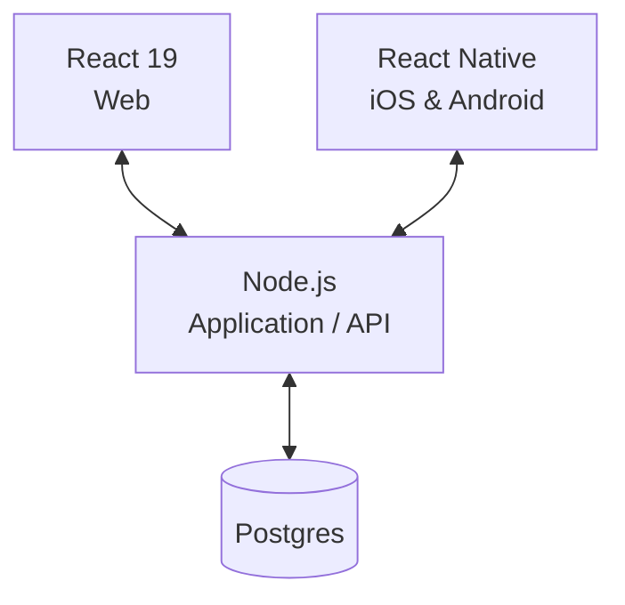

<p align="center">
  
</p>

<h1 align="center">Aces &amp; Ale</h1>

<p align="center">
  <strong>Eight players. Every match. Beyond the court.</strong><br>
  A tennis tournament project for web, iOS, and Android.
</p>

<p align="center">
  <a href="REQUIREMENTS.md">Requirements</a> &middot;
  <a href="ARCHITECTURE.md">Architecture</a> &middot;
  <a href="SECURITY.md">Security</a> &middot;
  <a href="DESIGN.md">Design</a>
</p>

---

> [!NOTE]
> **Project stage: specification.** This repository contains the product requirements, provisional architecture, design guidance, security posture, and logo. Application code, dependency manifests, build scripts, and tests have not been added yet.

## On and off the court

Aces & Ale brings together the planning for eight-player tennis tournaments: named participants, match plans, scores, statistics, and world and local rankings, alongside merchandising and beer garden management.

The intended audience includes **players, judges, administrators, press, trainers, and spectators**. Their responsibilities and permissions remain open.

| Area | Specified scope | Still to define |
| --- | --- | --- |
| **Tournament participation** | Exactly eight players per established tournament, identified by name. | Creation, enrollment, and when the player limit is enforced. |
| **Matches & planning** | A viewable match plan that identifies the competing participants. | Tournament format, singles or doubles, scheduling, and plan changes. |
| **Scoreboard** | Available scores displayed with the corresponding match and participants. | Scoring rules, score entry, corrections, and update timing. |
| **Rankings & statistics** | World and local rankings with explicit scope; statistics in the project scope. | Ranked entities, data sources, calculation rules, and statistic definitions. |
| **Merchandising & beer garden** | Both are part of the project scope. | Workflows, records, and supported actions. |

See [the functional requirements](REQUIREMENTS.md#functional-requirements) for the defined behavior and acceptance criteria, and [the open questions](REQUIREMENTS.md#open-questions) for unresolved product decisions.

## Planned architecture

The selected technologies are **React 19**, **React Native**, **Node.js**, and **Postgres**. The diagram shows the provisional logical boundaries described in [ARCHITECTURE.md](ARCHITECTURE.md); deployment and internal structure remain undecided.



Runtime versions other than React 19, implementation language, frameworks, package manager, API contract, database schema, hosting, and CI/CD are **TO BE DECIDED**.

## Design and security foundations

- **Accessible presentation.** The design targets WCAG 2.2 AA, readable scores beside player names, explicit ranking scope, keyboard access, responsive layouts, and reduced motion. See [DESIGN.md](DESIGN.md).
- **Passkey-only authentication.** Registration must encourage access on two devices; a second device is optional. Protected views, permissions, session handling, and recovery remain undecided. See [SECURITY.md](SECURITY.md#security-requirements).
- **Server authority.** The API is responsible for enforcing resolved permissions and business rules independently of either client. See [the trust boundaries](ARCHITECTURE.md) and [security controls](SECURITY.md#controls-and-trust-boundary-enforcement).

These are requirements and proposed controls for the future implementation; conformance and security verification have not yet been demonstrated.

## Explore the specifications

| Document | What it owns |
| --- | --- |
| [REQUIREMENTS.md](REQUIREMENTS.md) | Product behavior, actors, data, functional acceptance criteria, and open questions. |
| [ARCHITECTURE.md](ARCHITECTURE.md) | Technology choices, provisional components, interfaces, data flows, and diagrams. |
| [SECURITY.md](SECURITY.md) | Passkey policy, threat model, security requirements, controls, and verification expectations. |
| [DESIGN.md](DESIGN.md) | Logo use, visual defaults, layout, interaction patterns, and accessibility. |
| [REQUIREMENT_TEMPLATE.md](REQUIREMENT_TEMPLATE.md) | A template for one atomic, testable requirement, with traceability and acceptance criteria. |
| [logo.svg](logo.svg) | The original tennis-ball mark. |

The README is an entry point; the linked specifications own the detailed decisions. In particular, `SECURITY.md` records the later passkey constraint while the original requirements still leave authentication open.

## Getting started

Clone the repository to read and work on the specifications:

```sh
git clone https://github.com/jmanico/aces-and-ale.git
cd aces-and-ale
```

Start with [REQUIREMENTS.md](REQUIREMENTS.md), then read the architecture, security, and design documents. Use [REQUIREMENT_TEMPLATE.md](REQUIREMENT_TEMPLATE.md) when drafting an atomic requirement.

There is no runnable application yet. Local setup, build, test, and deployment commands are **TO BE DECIDED**.

<details>
<summary><strong>Decisions ahead</strong></summary>

- Tournament format, participant lifecycle, scoring rules, and match-plan changes.
- Statistics and ranking definitions, sources, and refresh behavior.
- Merchandising and beer garden workflows.
- Actor permissions, account enrollment, passkey recovery, and session policy.
- Brand direction, supported display modes, and implementation tooling.
- Hosting, integrations, operational objectives, and privacy requirements.

The open-question sections in the specification files track these decisions. `UNKNOWN` identifies missing facts, `TO BE DECIDED` identifies unresolved choices, and `ASSUMPTION` identifies provisional proposals.

</details>
